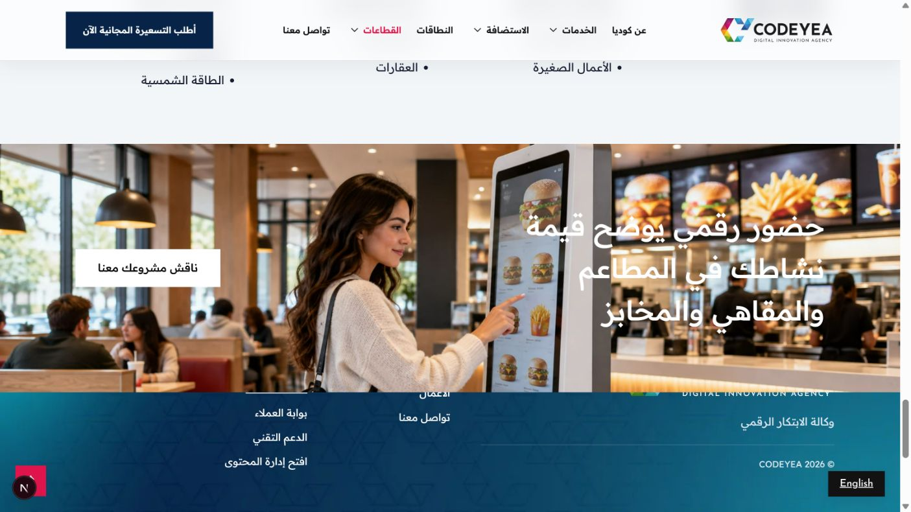
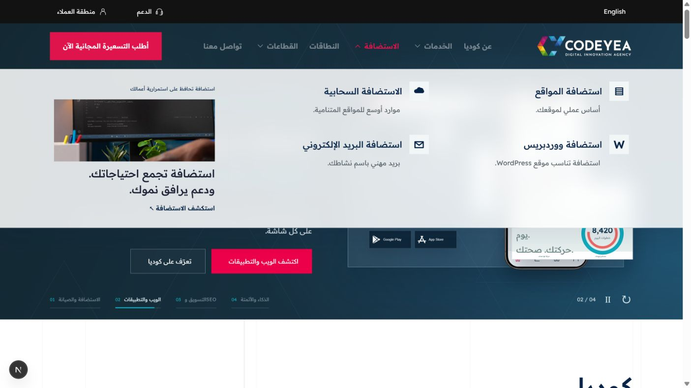
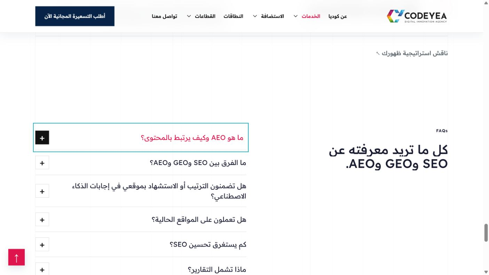

# سجل تصحيحات مراجعة النسخة الحية، 2026-10-21

أذن المالك بتوثيق وتنفيذ الملاحظات الآن، ثم تسليمه قائمة للمراجعة. جميع التغييرات باللغتين وفي كل مواضع السكشن المشترك، إلا التصحيحات الخاصة بصياغة أو خط العربية. طُبّق 38 بنداً على نسخة المراجعة المحلية. البند 31 معلّق لغياب الصفحة المقصودة. الصور والتصميم بانتظار مراجعة المالك، ونتائج الفحص التقنية لا تعني اعتماداً بصرياً.

| رقم | المطلوب | نطاق المراجعة | الحالة |
| --- | --- | --- | --- |
| 01 | تصغير عناصر هيرو الرئيسية قليلاً، سحبها داخل حدود المحتوى، وإظهار تنقل السلايدر ضمن الشاشة الأولى | الرئيسية AR/EN، حاسبة وتابلت وموبايل | مطبق محلياً، بانتظار المراجعة |
| 02 | توحيد قياسات خطوط الميغا منيو، تخفيف ضخامة العربية، ونقل فاصل الاستضافة والقطاعات بين الروابط والكارد | Services / Hosting / Industries | مطبق محلياً، بانتظار المراجعة |
| 03 | إبطاء وتنسيق حركة تبديل لون هوفر زر التسعيرة | كل مواضع الزر | مطبق محلياً، بانتظار المراجعة |
| 04 | إصلاح موضع THE IDENTITY العمودي | كايس ستادي Iraq Home Expo | مطبق محلياً، بانتظار المراجعة |
| 05 | مطابقة خطوط وألوان وأحجام صفحات الكايس ستادي مع الموقع | كل الكايس ستادي | مطبق محلياً، بانتظار المراجعة |
| 06 | ضبط المحتوى الداخلي لشريط المقدمة الأسود على حدود عرض الموقع | كل صفحات الخدمات والمواضع المشتركة | مطبق محلياً، بانتظار المراجعة |
| 07 | تكبير الصورة عند الضغط على كاملها أو Preview | كل كروت ومعارض الصور التي تحمل هذا الخيار، والكروت الثلاثة الإضافية | مطبق محلياً، بانتظار المراجعة |
| 08 | تقليل حجم السؤال والمسافات بين الكتابة والفاصل | كل سكشنات FAQ | مطبق محلياً، بانتظار المراجعة |
| 09 | هوفر أحمر وزحف بسيط سلس لعناوين What the service can include | كل مواضع الأكورديون | مطبق محلياً، بانتظار المراجعة |
| 10 | إضافة حركة الهوفر المعتمدة إلى Discuss Your Search Visibility | SEO AR/EN | مطبق محلياً، بانتظار المراجعة |
| 11 | إضافة AEO للأسئلة والعناوين وتغيير المسار إلى /services/seo-geo-aeo/ وتحديث الروابط وتحويل القديم | AR/EN وكل الروابط الداخلية | مطبق محلياً، بانتظار المراجعة |
| 12 | تطبيق هوفر FAQ على أكورديون المزايا مثل A storefront that makes shopping easy | كل نسخ السكشن | مطبق محلياً، بانتظار المراجعة |
| 13 | إضافة خلفية مصورة لكل CTA بلون فقط، وإضافة CTA لصفحة عن كوديا | الصفحات كلها وAbout AR/EN | مطبق محلياً، بانتظار المراجعة |
| 14 | جعل خلفية جداول الاستضافة ملء عرض الشاشة | كل صفحات الاستضافة | مطبق محلياً، بانتظار المراجعة |
| 15 | منع القفزة التلقائية من آخر سلايد SitePad إلى السكشن التالي | كل stacked showcase AR/EN | مطبق محلياً، بانتظار المراجعة |
| 16 | جعل كروت Explore what's included بعرض المحتوى المعتاد | كل مواضع السكشن | مطبق محلياً، بانتظار المراجعة |
| 17 | شفافية خفيفة وتأثير زجاج مغبش لخلفية جميع الميغا منيوز | AR/EN | مطبق محلياً، بانتظار المراجعة |
| 18 | استبدال صورة مقدمة المطاعم بمطعم داخلي وطاولة عليها طعام فاخر | نفس الموضع AR/EN | مطبق محلياً، بانتظار المراجعة |
| 19 | إضافة AEO في قائمة OUR SERVICES | كل مواضع القائمة | مطبق محلياً، بانتظار المراجعة |
| 20 | إضافة FAQs كعنوان صغير أينما مفقود وجعل العنوان الصغير والكبير sticky داخل سكشن الأسئلة | كل الصفحات | مطبق محلياً، بانتظار المراجعة |
| 21 | حذف Get in touch من FAQ لوجود CTA نهائي | كل مواضع FAQ | مطبق محلياً، بانتظار المراجعة |
| 22 | إظهار الوجوه كاملة في صور الإنشاءات والعقار والقانون والنفط والغاز والأسقف والأعمال الصغيرة | ضبط التأطير في النسختين، وعدم تغيير أبعاد السكشن | مطبق محلياً، بانتظار المراجعة |
| 23 | استبدال صورة المطبعة بصورة تحرير ونشر مجلة إلكترونية | Online Magazine / What publications need | مطبق محلياً، بانتظار المراجعة |
| 24 | استبدال صورة قهوة المطاعم العريضة بمطعم فخم وويتر يحمل تابلت للطلبات، ووجهه كامل | المطاعم AR/EN | مطبق محلياً، بانتظار المراجعة |
| 25 | استبدال CTA المطاعم بفاستفود وجهاز self order وشخص يطلب منه | المطاعم AR/EN | مطبق محلياً، بانتظار المراجعة |
| 26 | جملة هيرو الاتصال: وكالة الابتكار الرقمي، في سطر واحد | العربية | مطبق محلياً، بانتظار المراجعة |
| 27 | جعل العنوان العمودي فوق دائرة الهوفر ويبقى مرئياً | كل نسخ السكشن | مطبق محلياً، بانتظار المراجعة |
| 28 | إعادة تصميم صور كروت الخدمات الأربعة بتكوينات متنوعة غير مكررة، ومزامنتها | AI / SEO / Apps / Ecommerce AR/EN | مطبق محلياً، بانتظار المراجعة |
| 29 | خط الهيدر Regular بدلاً من Bold | كل الصفحات AR/EN | مطبق محلياً، بانتظار المراجعة |
| 30 | ترتيب جداول الدعم الفني وإضافة أيقونات وحركات هوفر مناسبة | Technical Support AR/EN | مطبق محلياً، بانتظار المراجعة |
| 31 | رابط الاستضافة الرئيسي يفتح صفحة الاستضافة الرئيسية، لا Website Hosting | كل الروابط المعنية AR/EN | معلق، الصفحة غير موجودة |
| 32 | استبدال صورة المجلة المطبوعة في بطاقة القطاع بصورة مجلة أونلاين | دليل القطاعات والمواضع المشتركة AR/EN | مطبق محلياً، بانتظار المراجعة |
| 33 | مزامنة كل صور الإنشاءات ومعالجة التكرار | Construction AR/EN | مطبق محلياً، بانتظار المراجعة |
| 34 | مزامنة كل صور سلايدر المعرض بكل القطاعات، صورة بصورة | جميع تفاصيل القطاعات | مطبق محلياً، بانتظار المراجعة |
| 35 | اعتماد ستايل الخط العربي لصفحات الخدمات في كل الصفحات العربية وتقليل Bold | العربية فقط | مطبق محلياً، بانتظار المراجعة |
| 36 | استبدال صورة Fashion/Lifestyle العريضة بصورة تعبر عن اللايف ستايل | AR/EN | مطبق محلياً، بانتظار المراجعة |
| 37 | مزامنة كل صور المطاعم مع الإنجليزية، مع تطبيق الاستبدالات السابقة على النسختين | restaurants-cafes-bakeries | مطبق محلياً، بانتظار المراجعة |
| 38 | مزامنة كل صور الطاقة الشمسية مع الإنجليزية | solar-energy | مطبق محلياً، بانتظار المراجعة |
| 39 | استبدال خلينا نحچي بعبارة لنتحدث عن مشروعك | كل مواضع العبارة العربية | مطبق محلياً، بانتظار المراجعة |

## أدلة المراجعة

إضافة المالك بعد المراجعة: ظل أسود لكتابات جميع أقسام CTA باللغتين. طُبّق على العناوين والوصف والعناوين الصغيرة وكتابة الأزرار، في الأقسام المصورة للخدمات والقطاعات والكايس ستادي وعن كوديا والنطاقات.

نسخة التطبيق الكاملة: http://127.0.0.1:3016/ . قاعدة المراجعة مستقلة `codeyea_owner_review_oct19`. لم يحصل نشر إلى Vercel أو تعديل لقاعدة الإنتاج بهذه الدفعة.

| المراجعة | العربي | الإنجليزي | البنود |
| --- | --- | --- | --- |
| الهيرو والهيدر والميغا منيو | [الرئيسية](http://127.0.0.1:3016/ar/) | [Homepage](http://127.0.0.1:3016/) | 01، 02، 03، 17، 29، 35 |
| كروت الخدمات وصورها وقائمة الخدمات | [الخدمات](http://127.0.0.1:3016/ar/services/) | [Services](http://127.0.0.1:3016/services/) | 06، 09، 19، 28 |
| AEO والمسار الجديد والـFAQ | [SEO / GEO / AEO](http://127.0.0.1:3016/ar/services/seo-geo-aeo/#services-faq) | [SEO / GEO / AEO](http://127.0.0.1:3016/services/seo-geo-aeo/#services-faq) | 08، 10، 11، 20، 21 |
| تكبير كل صورة، ومنها الكروت الإضافية | [تصميم المواقع](http://127.0.0.1:3016/ar/services/website-design/) | [Website Design](http://127.0.0.1:3016/services/website-design/) | 07 |
| هوفر أكورديون المزايا وخلفية CTA | [التجارة الإلكترونية](http://127.0.0.1:3016/ar/services/ecommerce/) | [Ecommerce](http://127.0.0.1:3016/services/ecommerce/) | 09، 12، 13 |
| خلفية الخطط، عرض الكروت، آخر سلايد | [الاستضافة](http://127.0.0.1:3016/ar/website-hosting/) | [Website Hosting](http://127.0.0.1:3016/website-hosting/) | 14، 15، 16 |
| تنظيم الجداول وأيقوناتها والهوفر | [الدعم الفني](http://127.0.0.1:3016/ar/services/technical-support/#ds-works) | [Technical Support](http://127.0.0.1:3016/services/technical-support/#ds-works) | 30 |
| CTA الجديد والعناوين العمودية فوق الدائرة | [عن كوديا](http://127.0.0.1:3016/ar/about/) | [About](http://127.0.0.1:3016/about/) | 13، 27، 39 |
| الصور الثلاث الجديدة للمطاعم | [المطاعم](http://127.0.0.1:3016/ar/industries/restaurants-cafes-bakeries/) | [Restaurants](http://127.0.0.1:3016/industries/restaurants-cafes-bakeries/) | 18، 24، 25، 37 |
| المجلات الرقمية في الدليل وداخل الصفحة | [دليل القطاعات](http://127.0.0.1:3016/ar/industries/)، [المجلات](http://127.0.0.1:3016/ar/industries/online-magazine/) | [Industries](http://127.0.0.1:3016/industries/)، [Online Magazine](http://127.0.0.1:3016/industries/online-magazine/) | 23، 32 |
| مزامنة الإنشاءات والعقار والشمسية | [الإنشاءات](http://127.0.0.1:3016/ar/industries/construction/)، [العقار](http://127.0.0.1:3016/ar/industries/real-estate/)، [الشمسية](http://127.0.0.1:3016/ar/industries/solar-energy/) | [Construction](http://127.0.0.1:3016/industries/construction/)، [Real Estate](http://127.0.0.1:3016/industries/real-estate/)، [Solar](http://127.0.0.1:3016/industries/solar-energy/) | 22، 33، 34، 38 |
| صورة اللايف ستايل | [اللايف ستايل](http://127.0.0.1:3016/ar/industries/fashion-and-lifestyle/) | [Lifestyle](http://127.0.0.1:3016/industries/fashion-and-lifestyle/) | 36 |
| عنوان الهوية وخطوط الكايس ستادي وخلفيات CTA | [Iraq Home Expo](http://127.0.0.1:3016/ar/case-studies/iraq-home-expo/)، [الدليل](http://127.0.0.1:3016/ar/case-studies/) | [Iraq Home Expo](http://127.0.0.1:3016/case-studies/iraq-home-expo/)، [Case studies](http://127.0.0.1:3016/case-studies/) | 04، 05، 13 |
| جملة هيرو الاتصال | [الاتصال](http://127.0.0.1:3016/ar/contact/) | تصحيح عربي فقط | 26 |

## البند المعلّق 31: الصفحة الرئيسية للاستضافة

المطلوب فتح صفحة رئيسية أخرى، وليس لوحة `hosting.codeyea.com` ولا Website Hosting. راجعت مسارات التطبيق، قوالب صفحات الاستضافة، سجل Git وقاعدة المراجعة. الموجود أربع صفحات: Website Hosting وWordPress Hosting وCloud Hosting وEmail Hosting، مع ملخص استضافة في الرئيسية `#hosting`. لا توجد صفحة مستقلة `/hosting/` أو سجل CMS لصفحة رئيسية أخرى. لم أنشئ صفحة بتصميم مفترض، ولم أستبدل الرابط بوجهة خاطئة ثانية. يحتاج هذا البند تحديد أصل الصفحة أو توجيهاً واضحاً لإنشاء صفحة جديدة.

## ما تم التحقق منه

- تحميل 40 زوجاً، أي 80 صفحة، دون أخطاء HTTP أو أخطاء بث الصفحة. [السجل](bilingual-review/routes.json).
- صور تفاصيل القطاعات الأربعة عشر متطابقة بين اللغتين، 10 صور لكل صفحة، مع تطابق المصادر المتجاوبة والخلفيات. لا يعني تطابق المصادر اعتماد جودة الصور. [الفحص المفصل](live-review-2026-10-21/checks.json).
- الاختلاف الوحيد في مقارنة بقية الصفحات هو شاشة مساعد CMS العربي والإنجليزي: صورة الشاشة مترجمة لكل لغة، وليست صورة قطاع غير متزامنة.
- المساران القديمان لخدمة البحث يرجعان 308 إلى المسار الجديد في كل لغة. الجديد يرجع 200، ويحتوي سؤال AEO، ولا يحتوي روابط داخلية قديمة للخدمة.
- بناء الإنتاج، TypeScript، فحص تركيب JavaScript، وعشرة اختبارات للروابط وعرض الكايس ستادي والتحكم بظهور الصور وحفظ رفع CMS المخصص نجحت.
- جرى فتح تكبير صورة من الكروت الإضافية بزر Enter وإغلاقها بـEscape. زر الإغلاق والنقر خارج الصورة متاحان أيضاً.
- خط تنقل الهيدر المحسوب 400 بعد إصلاح تعارض قاعدة عربية كانت تفرض 600. خلفيات الميغا منيو المحسوبة أبيض بشفافية 86% وblur بقيمة 22px، والفاصل بين الروابط والكارد.
- FAQ: أضيفت FAQs، وصار العنوان sticky، وحُذف رابط التواصل من عمود العنوان، وصار السؤال قرابة 20px على الحاسبة. تحقق فعلي من صفحتي المطاعم وخدمة البحث.
- آخر سلايد الاستضافة لم يعد يستدعي قفزة إلى السكشن التالي. السكشن يترك التمرير طبيعياً عند النهاية، ومع ارتفاع المحتوى فوق مساحة الشاشة. يبقى إحساس عجلة الماوس والتاتش باد بنداً بصرياً في مراجعة المالك.
- الهيرو: جرى التنقل بين السلايدات الأربعة في اللغتين، وتنقل السلايدات بقي ضمن الشاشة الأولى. عرض المحتوى 1200px على إطار فحص 1422px.
- 28 صورة مختلفة مستخدمة في المواضع المطلوبة، مع حفظ الأصول والأوامر في مجلد `Generated images` الرئيسي. مراجعة تأطير CTA عن كوديا أبدلت نسخته الأولى بصورة مخصصة أكثر للإطار العريض، والأصل الأول محفوظ أيضاً.

## مرجع المالك والتنفيذ جنباً إلى جنب

هذه مقارنة للملاحظة المحددة وليست ادعاء تطابق كامل التصميم أو اعتماد الصورة الجديدة.

| مرجع المالك | التنفيذ في الصفحة الكاملة |
| --- | --- |
|  |  |
|  |  |
|  |  |

[جداول الدعم الفني](live-review-2026-10-21/proof/support-tables-ar.png).

صور إضافية: [CTA عن كوديا](live-review-2026-10-21/proof/about-cta-ar.png)، [آخر سلايد الاستضافة](live-review-2026-10-21/proof/hosting-last-slide-en.png).

تفاصيل معنى الصور ومراجعها وإطاراتها في [سجل الصور](live-review-2026-10-21/IMAGERY.md). أوامر الصور وأصولها مسجلة في [الصور الأساسية](live-review-2026-10-21/assets.json)، [خلفيات CTA](live-review-2026-10-21/cta-assets.json)، [CTA الكايس ستادي](live-review-2026-10-21/case-cta-assets.json).
